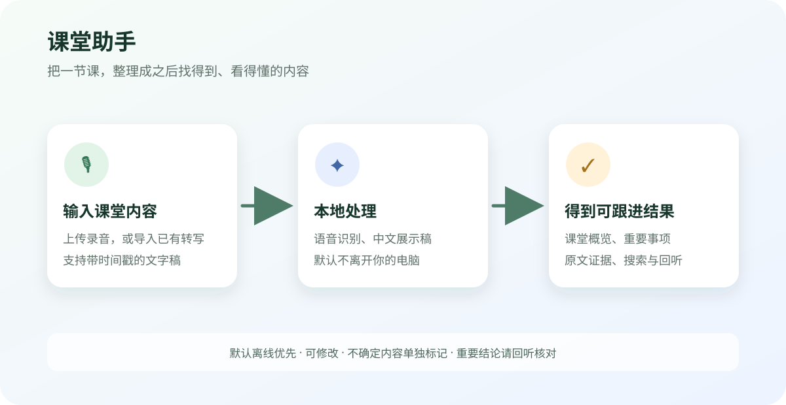

# 课堂助手 · Classroom Assistant

一个面向 Windows 的本地课堂内容整理工具：把课堂录音或已有转写文字，整理成课堂概览、时间轴笔记和重要事项。

> 这是一个由个人独立构思，并在 Codex 协助下完成的开源项目。它来自真实使用需求，目前仍处于持续完善阶段；部分功能、模型识别效果和安装体验可能不够完善，欢迎通过 Issues 反馈问题。




## 它能做什么

- 上传课堂录音，使用本机语音模型生成带时间戳的转写
- 导入已有文字稿，也可以粘贴带 `[mm:ss]` 时间戳的文字
- 英文或中英混合课堂可生成中文展示稿，同时保留识别原文供核对
- 自动整理课堂概览、时间轴分块和知识点
- 汇总作业、考试、通知、活动等重要事项，并保留原文证据
- 对不确定内容单独标记，方便回听确认
- 按周查看课表，按课程查看历史课堂
- 跨课程搜索转写、课堂概览和重要事项
- 支持修改转写、笔记和事项，并保留历史版本
- 默认在本机运行，支持 Windows 10/11 64 位

## 使用方式

### 浏览器版 / GitHub Pages

现在可以将轻量浏览器版部署为 GitHub Pages 网站，无需运行 Python 或维护服务器。
支持课程录音本地保存、浏览器内 Whisper 转写（实验性）、文字稿导入、时间戳回听、
原文事项摘录、手动笔记、搜索以及文字备份。首次自动转写需下载模型，录音不上传。

网页版使用当前浏览器的 IndexedDB，数据不与桌面版互通，也不会自动同步到 GitHub。
清除网站数据会删除记录，请定期导出文字备份，并单独下载原录音。
桌面版的完整 AI 概览、课表和模型管理继续保留；网页摘录不等于 AI 总结。

部署及功能差异见 [GitHub Pages 使用与部署](docs/GitHub-Pages.md)。

### Windows 版

普通用户不需要理解代码。下载 GitHub Releases 中的 Windows 安装包后：

1. 安装并打开“课堂助手”。
2. 第一次使用时，按向导添加学期和课程。
3. 在课程中上传录音，或导入已有转写文字。
4. 等待处理完成，查看课堂概览、重要事项和原文。

首次使用需要准备语音识别模型和文字分析模型，模型较大，建议在稳定网络下完成。模型准备好后，日常转写和分析默认可离线完成。

详细步骤见 [普通用户使用指南](docs/安装说明（普通用户）.md)。

## 隐私和数据

默认情况下，录音、转写、课程信息、课堂笔记和搜索索引都保存在用户自己的电脑上，不会自动上传到本项目或其他服务器。数据目录位于 `%LOCALAPPDATA%\ClassroomAssistant`，与程序安装目录分开。

如果用户主动在设置中选择 OpenAI 兼容服务，相关文字内容会发送到用户自己配置的服务地址；这不属于默认离线模式。完整说明见 [数据存储与隐私](docs/数据存储与隐私.md)。

仓库只包含通用源码和演示资源，不包含作者的真实录音、课程、课表、转写、数据库、模型、日志或密钥。

## 当前限制

- 语音识别质量取决于录音清晰度、授课语言和所选模型；重要细节仍应回听原音。
- 首次下载模型需要较多磁盘空间和网络时间。
- GPU 加速是否可用取决于目标电脑的 CUDA/cuDNN 运行环境；不可用时会回退到 CPU。
- 当前主要验证环境是 Windows；其他系统没有作为正式发布目标。
- 这是个人维护的实验性项目，不承诺长期兼容或无错误运行。

## 从源码运行

需要 Python 3.13、Node.js 20+ 和 Microsoft Edge WebView2 Runtime：

```powershell
python -m venv venv
venv\Scripts\activate
python -m pip install -r requirements.txt

cd frontend
npm ci
npm run build
cd ..

python run.py
```

仅启动本地后端进行调试：

```powershell
python run.py --no-gui
```

构建 Windows 版本前，先阅读 [开发者构建说明](docs/开发者构建说明.md)。

## 项目结构

```text
src/                 Python 后端、处理流水线和本地数据层
frontend/            React + TypeScript 前端
tests/               单元、集成和打包后检查
installer/           Inno Setup / NSIS 安装脚本
docs/                使用、隐私和开发文档
```

## 反馈和贡献

欢迎提交 Issue，最好附上：Windows 版本、应用版本、是否使用 GPU、复现步骤和脱敏后的日志。请不要上传录音、完整转写、课程表或任何密钥。

## 许可证

本项目使用 [MIT License](LICENSE)。第三方模型、运行库和依赖各自遵循其原许可证。
